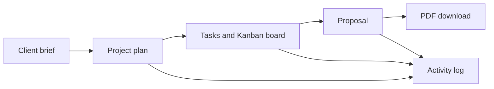

# MCP Agency Operations Assistant — Project Guide

## What this project is for

This is an operations workspace for a small agency. It turns a client's written brief into an organised project plan, a task board, and a proposal that can be downloaded as a PDF.

It has two ways to use the same system:

1. **Dashboard:** a normal website for the agency owner.
2. **MCP server:** a tool interface that an MCP-compatible AI client can call.

The dashboard and MCP server use the same saved projects, tasks, proposals, and activity history.

## What a user can do

1. Add a client name, project name, brief, and delivery timeline.
2. Create a structured three-phase plan: Discovery, Production, and Review.
3. Generate starter tasks or add custom tasks.
4. Move tasks through **To do**, **In progress**, **Blocked**, and **Done**.
5. Create a client proposal with scope, timeline, and investment note.
6. Download that proposal as a PDF.
7. Check the dashboard for project totals, task counts, and recent activity.

## The workflow in simple words

For example, an owner can enter: “Build a three-page fitness studio website in ten days.” The system saves the brief, creates a plan, creates delivery tasks, and makes a proposal from the approved scope.

## Main parts of the project

| Part | What it does | Why it exists |
| --- | --- | --- |
| Dashboard | Provides the visible website, project forms, task board, activity feed, and PDF download. | Lets an agency owner operate the tool without writing code. |
| FastAPI web application | Receives dashboard requests and serves the dashboard files. | Connects the browser to the application logic. |
| MCP server | Exposes planning actions as standard MCP tools and a dashboard resource. | Lets a compatible AI client perform the same planning work safely. |
| Database layer | Saves projects, tasks, proposals, and activity records. | Keeps the dashboard and MCP server in sync. |
| PDF generator | Builds a client-ready proposal PDF from saved proposal data. | Gives the owner a shareable deliverable. |
| Render deployment | Runs the dashboard and remote MCP endpoint on the public internet. | Makes the project accessible outside the local computer. |

## MCP tools explained

| Tool | What it does | Typical use |
| --- | --- | --- |
| `create_project_plan` | Saves a client project and creates Discovery, Production, and Review phases. | Start a new client job. |
| `create_tasks` | Saves one or more custom tasks. | Add work items after the scope is clear. |
| `list_tasks` | Shows tasks, optionally filtered by project or status. | Review the current workload. |
| `update_task_status` | Moves a task to a new status. | Keep the Kanban board current. |
| `draft_proposal` | Creates and saves a proposal from scope, timeline, and investment details. | Prepare a client-facing offer. |

There is also an `agency://dashboard` MCP resource. It returns project counts, task-status counts, and recent activity so an MCP client can understand the current workspace.

## How data is stored

The system stores four types of information:

| Data | Examples |
| --- | --- |
| Projects | Client name, project name, original brief, delivery plan. |
| Tasks | Title, description, priority, status, and due date. |
| Proposals | Proposal text linked to a project. |
| Activity log | A record of created projects, tasks, proposals, and task-status updates. |

When run locally, this data goes into a SQLite file. When `DATABASE_URL` is set to a PostgreSQL connection string, the app uses PostgreSQL instead. PostgreSQL is the correct choice for the public Render service because free Render storage is temporary.

## Security and access

The public service is protected with a private workspace key:

- `APP_ENV=production` enables production safeguards.
- `WORKSPACE_ACCESS_KEY` is the owner key.
- The dashboard asks for the key once in a browser session.
- Dashboard API routes and the remote `/mcp` endpoint require the key in the `x-workspace-key` request header.

Do not put the owner key or a database connection string in GitHub, the README, or a public screenshot.

## Live deployment

The application is live at https://mcp-assistant-58tz.onrender.com.

Render runs the application from the `main` branch using Docker. It is on Render's free web-service plan, so it sleeps after 15 minutes without traffic. The next visitor wakes it up, which can make the first page load take around a minute.

## What is complete

- Dashboard workflow for projects, tasks, proposal creation, activity, and PDF export.
- Standards-based remote MCP endpoint at `/mcp`.
- Access-key protection for the public dashboard APIs and MCP endpoint.
- Docker build and Render deployment.
- Automated tests for the main project, task, proposal, PDF, and dashboard flows.

## What should be done next

1. Create a Neon PostgreSQL database.
2. Add its connection string to Render as `DATABASE_URL`.
3. Create a test project and task in the live dashboard.
4. Restart the Render service and confirm the test data remains.

After that check, the tool is ready to retain real client operations data.
